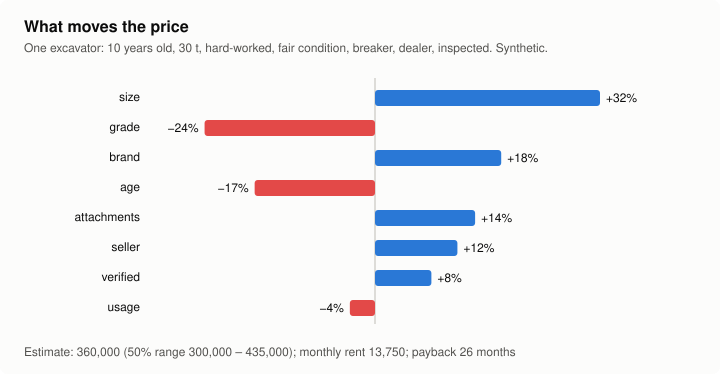
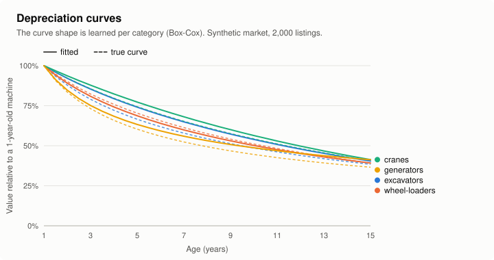
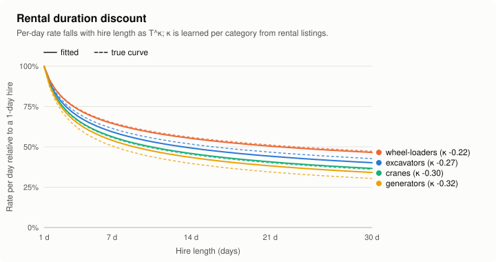
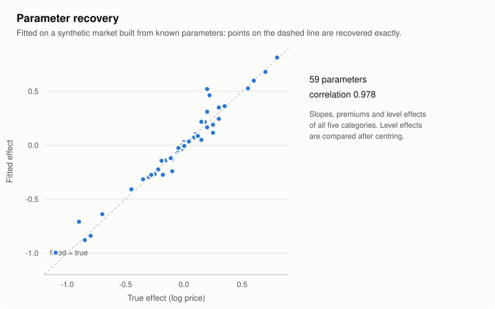
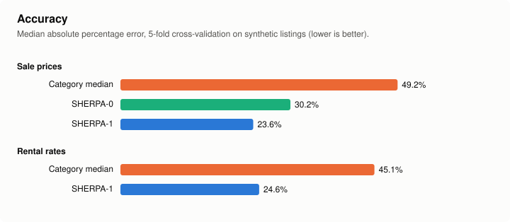
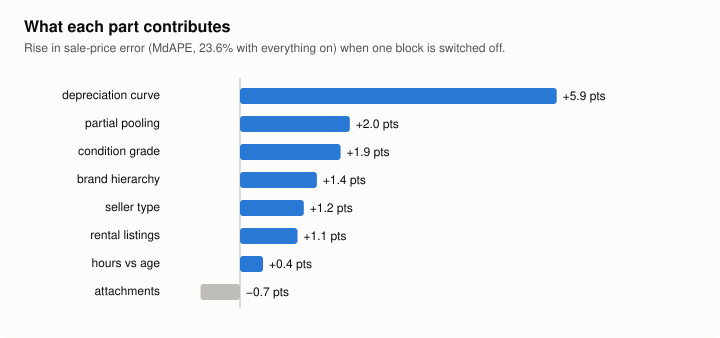
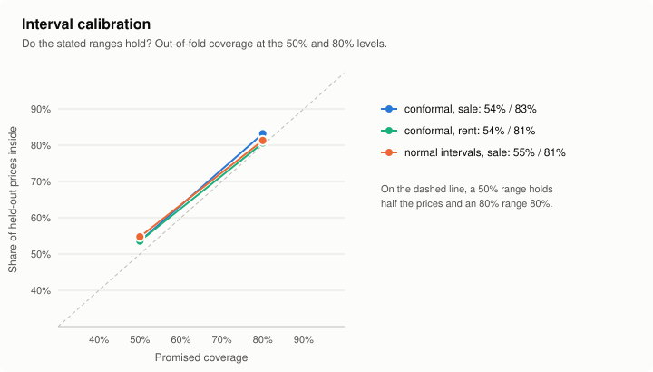

# SHERPA

**Shrinkage-based Heavy Equipment Residual Price Analysis** - an explainable model of **what a
used heavy machine is worth and what it rents for**, fitted from marketplace listings.

[](https://github.com/dev-kakosoai/sherpa-valuation/actions/workflows/ci.yml)
[](LICENSE)

Marketplaces for excavators, cranes, loaders and generators have few listings per category,
fields left empty, facts buried in free text, and outliers. SHERPA is built for that data:

- **One machine value, two markets.** Sale prices and rental rates are fitted jointly: a rental
  listing teaches the model about value, and a sale listing about rent.
- **Explainable.** Every input is a named effect on price - "−17% for age, +11% for a breaker".
- **Partial pooling everywhere.** A category, brand or level with few listings borrows strength
  from its parent (family, origin group, market).
- **Robust.** Medians and Theil-Sen slopes; one placeholder price does not move the fit.
- **Honest ranges.** Intervals are calibrated by conformal prediction, separately for listings
  with missing inputs.
- **TypeScript and Python**, no runtime dependencies, the same JSON in both.

## What it estimates

```text
Value      $350,000  (50%: $295,000 – $415,000)
Daily      $1,100
Weekly     $4,750
Monthly    $14,250
Payback    24.6 months of hire
  age          −17%
  usage         +3%
  attachments  +11%
  seller        +7%
  brand        +16%
```

<picture>
  <source media="(prefers-color-scheme: dark)" srcset="docs/img/factors-dark.svg">
  
</picture>

## The model

For a machine *x* in category *c*, the log value is a sum of named effects:

```text
V(x) = α_c + β_c·g_λc(age) + γ_c·log(size) + δ_c·usage(hours, age) + θ_c·[new] + η_grade
     + Σ ψ_attachment + ε_emissions + ζ_c·wear + φ_spec + κ_seller + ν·[inspected]
     + brand (→ origin group) + region + market index over time

sale:   log price       = V(x) + listing terms
rent:   log rate/day(T) = V(x) + π_c + κ_c·log(T/30) + ω_c·[operator]
```

`g_λ` is a Box-Cox depreciation curve whose shape is learned per category; `π_c` is the
rent-to-value level (the user cost of capital); `κ_c` the duration discount (longer hire, lower
rate per day). The full specification, estimation algorithm and assumptions are in
**[docs/MODEL.md](docs/MODEL.md)**; sources in **[docs/REFERENCES.md](docs/REFERENCES.md)**.

<picture>
  <source media="(prefers-color-scheme: dark)" srcset="docs/img/depreciation-dark.svg">
  
</picture>

<picture>
  <source media="(prefers-color-scheme: dark)" srcset="docs/img/duration-dark.svg">
  
</picture>

## Results on synthetic markets

All charts and numbers come from **synthetic markets with known parameters**
(`syntheticMarket1`), so the fit can be checked against the truth. No real listings are
distributed with this repository.

<picture>
  <source media="(prefers-color-scheme: dark)" srcset="docs/img/recovery-dark.svg">
  
</picture>

Five-fold cross-validation on 1,200 synthetic listings (600 sale, 600 rental, five categories),
`npm run bench`:

| | Sale prices, MdAPE | Rental rates, MdAPE | 50% range holds | 80% range holds |
| --- | ---: | ---: | ---: | ---: |
| Category median | 49.2% | 45.1% | – | – |
| SHERPA-0 (sale only) | 30.2% | – | – | – |
| **SHERPA-1** | **23.6%** | **24.6%** | 53.6% (sale) · 53.6% (rent) | 83.2% · 80.6% |

MdAPE is the median absolute percentage error of the typical estimate on held-out listings.

<picture>
  <source media="(prefers-color-scheme: dark)" srcset="docs/img/accuracy-dark.svg">
  
</picture>

Switching off one block at a time shows what each part contributes. The flexible depreciation
curve matters most; fitting rental listings jointly makes sale estimates better too. The
attachment effects in this synthetic market are small (+3% to +10%, on a quarter of listings),
and estimating them costs a little more than it gains.

<picture>
  <source media="(prefers-color-scheme: dark)" srcset="docs/img/ablation-dark.svg">
  
</picture>

<picture>
  <source media="(prefers-color-scheme: dark)" srcset="docs/img/calibration-dark.svg">
  
</picture>

On this synthetic market the errors are close to normal, so normal intervals do about as well
as conformal ones; the conformal calibration earns its place on real data with heavy tails and
gaps, where it is distribution-free.

## Install

```bash
npm install @equipmentsfinder/sherpa      # TypeScript / JavaScript
pip install sherpa-valuation              # Python
```

## Use

```ts
import { fitSherpa, estimateSherpa, syntheticMarket1 } from '@equipmentsfinder/sherpa';

const { listings } = syntheticMarket1({ sale: 120, rent: 120, seed: 1 }); // or your own
const model = fitSherpa(listings, { market: 'XX', currency: 'USD', asOfYear: 2026 });

estimateSherpa(model, {
  category: 'excavators',
  brand: 'Alpha',
  origin: 'japan',
  year: 2016,
  size: 20,
  hours: 9000,
  grade: 3,
  attachments: ['breaker'],
});
// { value: { low, typical, high }, rates: { daily, weekly, monthly },
//   monthlyYield, paybackMonths, confidence, factors, missing, comparables }
```

```python
from sherpa_valuation import fit_sherpa, estimate_sherpa, synthetic_market

listings, truth = synthetic_market(sale=120, rent=120, seed=1)
model = fit_sherpa(listings, {"market": "XX", "currency": "USD", "asOfYear": 2026})
estimate_sherpa(model, {"category": "excavators", "year": 2016, "size": 20})
```

A listing is a plain object: `side` (`'sale'` or `'rent'`), `category`, `price` (for a rental,
the rate for `period` days), and any of `family`, `brand`, `origin`, `year`, `size`, `hours`,
`condition`, `grade` (1-4), `attachments`, `emissions`, `wear` (0-1), `spec`, `seller`,
`verified`, `region`, `operator`, `month`, `monthsOnMarket`, `completeness`. Fit one model per
market; prices from different countries are not pooled.

**SHERPA-0**, the simpler sale-only baseline the evaluation compares against, is exported as
`fitPriceModel` / `estimatePrice`, with text extraction of year, size and hours from listing
titles (`extractYear`, `extractMachineSize`, `extractHours`).

## Development

```bash
npm ci
npm test            # TypeScript tests
npm run bench       # cross-validation, baselines, ablations -> bench/results.json
npm run charts      # README charts -> docs/img
npm run recovery    # fitted vs true parameters
npm run fixtures    # cross-language fixtures for the Python test
cd python && pip install -e '.[test]' && pytest
```

## Limitations

- SHERPA models **asking** prices and rates, not transaction prices.
- The new-machine premium and the curve shape near age 0 are weakly identified together
  ([MODEL.md §8](docs/MODEL.md#8-identifiability-and-assumptions)).
- Results here are on synthetic data; real-market results will be reported separately.

## Citing

See [CITATION.cff](CITATION.cff). A paper describing the model is in preparation.

## Licence

Apache License 2.0. Copyright 2026 EquipmentsFinder. Contributions welcome - see
[CONTRIBUTING.md](CONTRIBUTING.md).
